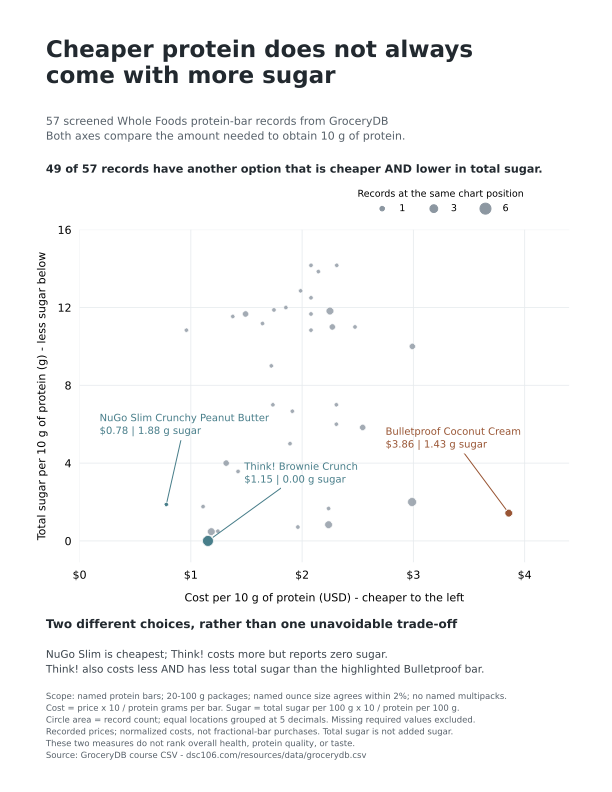

# DSC 106 Project 1: Protein Bar Value

This project was featured in the “Best Project 1 Awards” slides for DSC 106 at UC San Diego.

Does cheaper protein always come with more sugar?

This project compares protein bars sold at Whole Foods using GroceryDB data. I used Python, pandas, and Matplotlib to clean the data and compare cost and total sugar per **10 g of protein**.

## Main finding

Of the 57 records included in the analysis, **49 had another option that was both cheaper and lower in total sugar per 10 g of protein**.

This shows that choosing a lower-cost source of protein does not always require accepting more sugar. The finding applies to the selected records, not every protein bar on the market.

## How to read the chart

| Visual element | Meaning |
| --- | --- |
| Horizontal axis | Cost in USD per 10 g of protein. Further left means lower cost. |
| Vertical axis | Total sugar in grams per 10 g of protein. Lower means less sugar. |
| Circle area | Number of records at the same plotted coordinates. |
| Teal circles | Highlighted NuGo Slim and Think! examples. |
| Orange circle | The highlighted Bulletproof example. |
| Gray circles | Other records in the analysis. |

A point to the **left and below** another point represents an option that is both cheaper and lower in total sugar for the same amount of protein.

### Why some records share a circle

The final dataset contains **57 records with 57 distinct product names**, but only **36 distinct plotted positions**.

Different products can have matching cost and sugar values after normalization. For plotting, both coordinates are rounded to five decimal places, and records with matching coordinate pairs are grouped.

A larger circle represents more records at that position. Circle area, rather than radius, scales with the record count.

This does not mean the records are duplicate products or come from the same physical location. They simply share a position on the chart.

The grouping is only used for drawing. The **49 out of 57** finding is calculated from the individual records using unrounded values.

For example, six records, including Brownie Crunch, Lemon Delight, and White Chocolate, share one point on the chart. They all cost about $1.15 per 10 g of protein and have 0 g of recorded total sugar per 10 g of protein.

## Highlighted examples

### NuGo Slim: the lowest protein cost

The highlighted NuGo Slim Crunchy Peanut Butter bar has the lowest cost per 10 g of protein among the analyzed records.

This refers to the normalized protein cost, not necessarily the lowest purchase price for a whole bar.

### Think!: zero recorded total sugar

The highlighted Think! Brownie Crunch bar costs more per 10 g of protein than the NuGo Slim example, but its total sugar value is recorded as zero.

“Zero recorded sugar” describes the dataset. This project did not independently test the product.

### Think! compared with Bulletproof

The highlighted Think! example costs less and has less total sugar per 10 g of protein than the highlighted Bulletproof Coconut Cream example.

This comparison concerns those specific records, not every product sold by either brand.

Together, these examples explain the chart’s message: **a price–sugar trade-off is not unavoidable**. Some choices offer a lower cost, some offer less sugar, and some outperform another option on both measures.

## Data source and scope

Source: [GroceryDB course CSV](https://dsc106.com/resources/data/grocerydb.csv)

The original CSV contains **26,250 food records** across Target, Walmart, and Whole Foods.

The code identifies protein-bar candidates as records in the `snacks-bars` category whose names contain the word `protein` and either `bar` or `bars`.

| Scope | Original records | After removing exact duplicate rows | Distinct product names |
| --- | ---: | ---: | ---: |
| Protein-bar candidates across all stores | 386 | 385 | 383 |
| Whole Foods protein-bar candidates | 150 | 149 | 147 |
| Final analysis after all filters | — | 57 | 57 |

Distinct product names are not necessarily distinct product identities. Different flavors, package sizes, and naming variations can count separately.

The visualization uses only the final **57 Whole Foods records**.

## Data cleaning

The script:

1. Removes exact duplicate rows from the full dataset, eliminating 58 rows.
2. Selects Whole Foods protein-bar candidates.
3. Removes records missing price, package weight, protein, or total sugar.
4. Requires positive price, package weight, and protein.
5. Checks that protein and sugar values are plausible for nutrition reported per 100 g of food.
6. Keeps packages weighing 20–100 g.
7. Converts the ounce weight in each product name to grams and requires agreement with the recorded package weight within 2%.
8. Excludes names that explicitly indicate multipacks, boxes, or cases.

| Stage | Records remaining |
| --- | ---: |
| Whole Foods candidates after exact duplicate removal | 149 |
| After required-value and plausibility checks | 115 |
| After the 20–100 g package-weight filter | 68 |
| After named-weight agreement and multipack filters | 57 |

These filters aim to make single-bar comparisons more consistent. They can exclude valid products with incomplete names and do not guarantee that every packaging detail is correct.

## Calculations

The source nutrition values are reported per 100 g of food.

```text
Protein per bar = protein per 100 g × package weight / 100

Cost per 10 g protein = price × 10 / protein per bar

Sugar per 10 g protein = total sugar per 100 g × 10 / protein per 100 g
```

For example, a $3 bar containing 20 g of protein and 4 g of total sugar would have:

- A cost of **$1.50 per 10 g of protein**.
- **2 g of total sugar per 10 g of protein**.

These are comparison units. They do not mean a shopper can purchase half a bar for $1.50.

### Counting cheaper, lower-sugar alternatives

For each record, the script searches for another record with both:

- A strictly lower cost per 10 g of protein.
- Strictly less total sugar per 10 g of protein.

The original record is counted once if an alternative exists, even when several alternatives qualify.

This produces the result of **49 out of 57 records**.

## Limitations

- Prices are recorded dataset values, not verified current prices.
- The analysis covers a filtered subset of Whole Foods protein bars.
- Name-based filters can miss relevant products or incomplete packaging information.
- Total sugar is not the same as added sugar. The analysis does not isolate added sugar.
- Zero sugar values reflect the source data rather than independent measurements.
- Cost and sugar do not measure overall health, protein quality, taste, or individual dietary suitability.
- Having no strictly cheaper and lower-sugar alternative does not automatically make a product the best overall choice.

## Feedback and revision

Class feedback noted that the visualization had a clear question, helpful color highlights, and an interesting use of circle size to represent overlapping records.

One suggestion was to clarify the original legend phrase, “Records sharing a location.” The word “location” could be mistaken for a store or geographic location.

For the portfolio version, I revised the legend to clarify that it refers to **a position on the chart**. The underlying analysis and grouping method remain unchanged.

## What I learned

A consistent comparison unit matters. Comparing prices per bar alone would ignore differences in protein content.

Overlapping points can hide records. Grouping matching chart positions and representing their counts through circle area makes that information visible.

The feedback also showed why wording matters: readers should be able to understand a legend without inspecting the code.

## Code and data

The analysis and chart-generation code is in [`project1.py`](project1.py).

The source CSV is not included in this repository. To run the analysis, download it from the linked data source and save it as `grocerydb.csv` in the same folder as `project1.py`.

The script requires Python, pandas, and Matplotlib. It generates a PDF chart; the PNG shown above was exported from the PDF.

## Author

Sungsan Rhie  
UC San Diego — DSC 106: Data Visualization